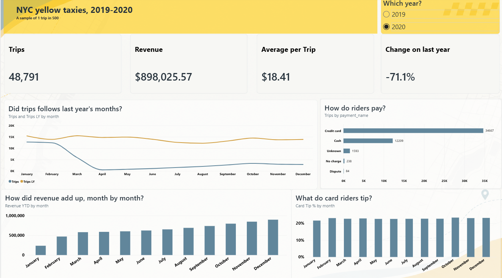
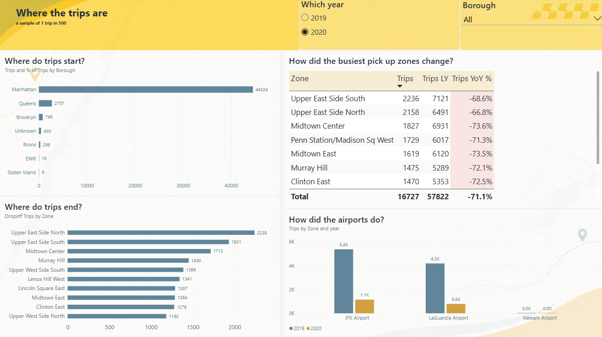
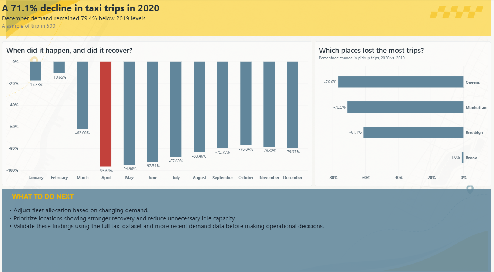

# NYC Yellow Taxi Analytics Dashboard | 2019–2020


## Project Overview

This project presents an interactive Power BI dashboard analyzing New York City yellow taxi trips between 2019 and 2020.

The objective is to understand changes in taxi demand, revenue, passenger spending, tipping behavior, and geographic trip patterns, with a particular focus on the significant decline in demand during 2020.

The project covers the complete business intelligence workflow, from data cleaning and modeling to DAX calculations, interactive dashboard development, and business storytelling.

This project was completed as part of the ASAC Data Science Bootcamp at LTUC.

## Business Objectives

- Analyze taxi trips and revenue across 2019 and 2020.
- Measure year-over-year changes in taxi demand.
- Identify the months and boroughs most affected by declining demand.
- Explore pickup and drop-off patterns across NYC taxi zones.
- Analyze average revenue per trip and credit card tipping behavior.
- Provide actionable recommendations for taxi fleet management.

## Dataset Overview

The dataset represents approximately one out of every 500 NYC yellow taxi trips during 2019 and 2020.

| Metric | Value |
|---|---:|
| Total sampled trips | 217,338 |
| 2019 trips | 168,547 |
| 2020 trips | 48,791 |
| Total sampled revenue | $4,116,717.47 |
| Sampling rate | 1 in 500 |
| Analysis period | January 2019 – December 2020 |

## Tools and Technologies

- Microsoft Power BI Desktop
- Power BI Service
- Power Query
- M Language
- DAX (Data Analysis Expressions)
- Dimensional Data Modeling
- Git and GitHub

## Project Workflow

1. Import and inspect the source data.
2. Clean and transform the data using Power Query.
3. Build a dimensional data model.
4. Create analytical measures using DAX.
5. Develop three interactive report pages.
6. Identify significant trends and business insights.
7. Communicate findings through data storytelling.
8. Publish the report to Power BI Service.

## Data Cleaning and Transformation

Power Query was used to prepare the dataset for analysis.

The main cleaning operations included:

- Filtering pickup dates to the 2019–2020 analysis period.
- Checking that drop-off timestamps are not earlier than pickup timestamps.
- Excluding records with negative total amounts.
- Preparing date fields and relationship keys for data modeling.
- Retaining unusual but potentially valid records, including zero-distance trips.

Zero-distance trips were retained because a recorded distance of zero does not necessarily indicate that a trip did not occur. Meter errors are one possible explanation.

## Data Model

The report uses a dimensional model with a central trips fact table and four supporting dimension tables.

| Table | Purpose |
|---|---|
| `trips` | Taxi trip records and financial values |
| `dates` | Date-based analysis and time intelligence |
| `zones` | Geographic pickup and drop-off analysis |
| `payment_types` | Payment method descriptions |
| `rate_codes` | Taxi fare rate classifications |

The model includes active relationships for pickup-based analysis and an inactive relationship for drop-off analysis.

The inactive relationship is activated within the relevant DAX measure using `USERELATIONSHIP`.

## DAX Measures

### Trips

```dax
Trips = COUNTROWS(trips)
```

### Revenue

```dax
Revenue = SUM(trips[total_amount])
```

### Average per Trip

```dax
Average per Trip =
DIVIDE([Revenue], [Trips])
```

### Trips Last Year

```dax
Trips LY =
CALCULATE(
    [Trips],
    SAMEPERIODLASTYEAR(dates[date])
)
```

### Year-over-Year Trip Change

```dax
Trips YoY % =
DIVIDE(
    [Trips] - [Trips LY],
    [Trips LY]
)
```

### Year-to-Date Revenue

```dax
Revenue YTD =
TOTALYTD([Revenue], dates[date])
```

### Percentage of Trips

```dax
% of Trips =
DIVIDE(
    [Trips],
    CALCULATE(
        [Trips],
        REMOVEFILTERS(zones)
    )
)
```

### Drop-off Trips

```dax
Dropoff Trips =
CALCULATE(
    [Trips],
    USERELATIONSHIP(
        trips[DOLocationID],
        zones[LocationID]
    )
)
```

### Credit Card Tip Percentage

```dax
Card Tip % =
CALCULATE(
    DIVIDE(
        SUM(trips[tip_amount]),
        SUM(trips[fare_amount])
    ),
    payment_types[payment_name] = "Credit card"
)
```

## Dashboard Preview

### Page 1 — Overview



The Overview page provides a high-level summary of taxi demand and financial performance.

Key features:

- Total trips and revenue KPI cards.
- Average revenue per trip.
- Year-over-year trip change.
- Monthly trip trends.
- Year-to-date revenue analysis.
- Credit card tipping analysis.
- Interactive year selection.

### Page 2 — Places



The Places page explores geographic differences in taxi demand and trip distribution.

Key features:

- Pickup trips by borough and zone.
- Percentage contribution of pickup zones.
- Top 10 pickup locations.
- Top 10 drop-off locations.
- Airport-related trip analysis.
- Interactive geographic filtering.

### Page 3 — Story



The Story page communicates the most important analytical finding through focused visual evidence and business recommendations.

It highlights the decline in taxi demand during 2020 and identifies when and where the largest percentage changes occurred.

## Key Findings

### 1. Taxi demand declined significantly in 2020

| Metric | 2019 | 2020 |
|---|---:|---:|
| Sampled trips | 168,547 | 48,791 |
| Revenue | $3,218,691.90 | $898,025.57 |
| Average revenue per trip | $19.10 | $18.41 |
| Credit card tip percentage | 22.6% | 23.4% |

Sampled taxi trips declined by 71.1% in 2020 compared with 2019.

### 2. April experienced the largest decline

April 2020 recorded a 96.6% year-over-year decline in taxi trips.

Although demand improved after April, December 2020 still recorded 79.4% fewer trips than December 2019.

### 3. Geographic demand patterns changed

Queens experienced the largest percentage decline among the four boroughs displayed in the Story page, with a decrease of approximately 76.6%.

This represents a percentage decline rather than the largest absolute number of trips lost.

### 4. Average spending remained relatively stable

While the number of trips declined substantially, average revenue per trip decreased from $19.10 to $18.41.

This suggests that the decline in trip volume was a major contributor to the reduction in overall revenue.

## Business Recommendations

- Adjust taxi fleet allocation and driver shifts based on changing demand.
- Prioritize pickup zones and operating times with stronger recent demand.
- Reduce unnecessary vehicle availability in areas with consistently low demand.
- Monitor trip volumes, revenue, and geographic recovery patterns.
- Validate historical findings using newer and more complete trip records before making operational decisions.

## Dashboard Design

The report uses a NYC taxi-inspired visual theme with:

- Taxi yellow as the primary accent color.
- Charcoal and neutral background colors.
- A subtle NYC street-map background.
- Consistent typography and visual hierarchy.
- Conditional formatting for year-over-year changes.
- KPI cards for important business metrics.
- Focused storytelling to communicate the main finding.

The design prioritizes readability, visual consistency, and business usability.

## Data Limitations

- The dataset contains approximately 0.2% of NYC yellow taxi trips.
- Reported trip counts and revenue totals represent the sample rather than exact citywide totals.
- Multiplying the sampled totals by 500 would produce estimates, assuming the sample is representative.
- The analysis covers only 2019 and 2020 and should not be treated as a description of current taxi demand.
- Credit card tipping analysis reflects recorded card tips and does not measure unrecorded cash tips.
- Operational recommendations require validation using recent data.

## Repository Contents

| File | Description |
|---|---|
| [Power BI Dashboard](./A03_Moslem_Al-Issa.pbix) | Interactive Power BI report |
| [Project Report](./A03_Moslem_Al-Issa.pdf) | Data storytelling, methodology, DAX measures, and report evidence |
| [Screenshots](./screenshots) | Dashboard page previews |
| README.md | Project documentation |

## How to Run

1. Download the `.pbix` file.
2. Open it using Microsoft Power BI Desktop.
3. Navigate between the Overview, Places, and Story report pages.
4. Use the slicers to explore the available data.
5. If refreshing the report, configure the required source data connections.

## Source Code

The following files provide direct access to the
report's analytical calculations and data cleaning
logic without requiring Power BI Desktop.

| File | Description |
|---|---|
| [DAX Measures](./dax/measures.dax) | All nine DAX measures used in the dashboard |
| [Power Query M](./power-query/data_cleaning.pq) | Data cleaning and transformation of the trips table |

## What I Learned

Through this project, I developed practical experience in:

- Data cleaning and transformation using Power Query.
- Dimensional data modeling and table relationships.
- Active and inactive relationship management.
- DAX measure development.
- Time intelligence calculations.
- Year-over-year and year-to-date analysis.
- Interactive slicers and visual interactions.
- Geographic data analysis.
- Dashboard design and conditional formatting.
- Business intelligence reporting and data storytelling.

## Author

**Moslem Al-Issa**

ASAC Data Science Trainee | Aspiring Data Analyst

---

*This project was developed for educational purposes as part of the ASAC Data Science Bootcamp.*
